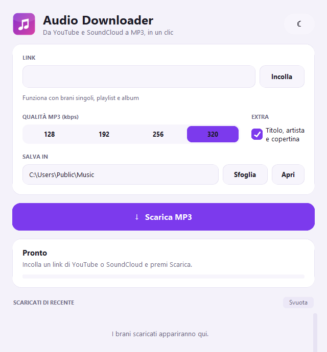

# Audio Downloader per Windows

Scarica l'audio di **YouTube** e **SoundCloud** in **MP3** (fino a 320 kbps), con titolo, artista e copertina già inseriti.
Funziona con brani singoli, playlist e album. Tema chiaro e scuro.



## Installazione (consigliata, un minuto di lavoro)

1. Apri **PowerShell**: premi il tasto **Windows**, scrivi `PowerShell` e premi Invio.
2. Copia questa riga, incollala in PowerShell (tasto destro o `Ctrl + V`) e premi Invio:

   ```powershell
   irm https://raw.githubusercontent.com/madashi14/audio_downloader_win/main/installer/installa.ps1 | iex
   ```

3. Aspetta qualche minuto. Alla fine l'app si apre da sola e la trovi sul **Desktop** e nel **menu Start** (scrivi "Audio").

Non servono permessi di amministratore e non viene toccato nient'altro sul PC: Python, ffmpeg e il resto finiscono nella cartella
`%LOCALAPPDATA%\AudioDownloader` (circa 600 MB).

## Installazione con doppio clic (alternativa)

1. Scarica **Audio-Downloader-Windows.zip** dalla pagina [Releases](https://github.com/madashi14/audio_downloader_win/releases/latest).
2. Tasto destro sullo zip → **Estrai tutto**, poi nella cartella estratta fai doppio clic su **Installa Audio Downloader.cmd**.
3. Se Windows avvisa che il file viene da internet, premi **Esegui** (oppure **Ulteriori informazioni → Esegui comunque**).
   Succede solo perché il file non è firmato digitalmente: il metodo con PowerShell qui sopra evita questo passaggio.

## Aggiornare

Rifai l'installazione: sostituisce l'app con l'ultima versione e mantiene impostazioni e cronologia.

## Disinstallare

**Impostazioni → App → App installate → Audio Downloader → Disinstalla**, come per qualsiasi programma.
In alternativa, doppio clic su **Disinstalla Audio Downloader.cmd** nella cartella dello zip. Gli MP3 scaricati restano dove sono.

## Requisiti

- Windows 10 o 11 a 64 bit (testato su Windows 11)
- Connessione a internet e circa 1 GB di spazio libero durante l'installazione (poi ne occupa circa 600 MB)

## Problemi comuni

- **"YouTube chiede di dimostrare che non sei un robot"**: YouTube a volte blocca i download da VPN,
  reti aziendali o condivise. Spegni la VPN o riprova più tardi; SoundCloud non ha questo problema.
- **Il comando dà errore in rosso appena incollato**: assicurati di averlo incollato in **PowerShell**
  (non nel Prompt dei comandi) e che la riga sia completa.
- **L'antivirus blocca l'installazione**: alcuni antivirus diversi da Microsoft Defender diffidano dei comandi
  scaricati da internet. Usa l'installazione con doppio clic, o consenti l'operazione nell'antivirus.
- **Qualcosa non va dopo un aggiornamento di Windows**: rifai l'installazione, sistema tutto e mantiene la cronologia.

## Uso responsabile

Scarica solo contenuti che hai il diritto di scaricare (per esempio i tuoi, o con licenza che lo permette).

---

### Per chi sviluppa

| Cartella | Cosa c'è |
|---|---|
| `app/` | l'app: `gui.py` (interfaccia, customtkinter), `downloader.py` (yt-dlp + ffmpeg), `piattaforma.py` (differenze Windows/Mac) |
| `installer/` | `installa.ps1` (micromamba + conda-forge: Python, Tk, ffmpeg; pip: yt-dlp, Deno, customtkinter; icone e voce in "App installate"), `controlla.py` (verifica finale), `disinstalla.ps1` |
| `tests/` | `test_download.py` (download veri controllati con ffprobe), `test_gui.py` (pilota l'interfaccia e fa screenshot) |
| `strumenti/` | `genera_icona.py` (disegna `app/assets/icon.png` e `icon.ico`) |

La versione per Mac è in [madashi14/audio-downloader-mac](https://github.com/madashi14/audio-downloader-mac).
